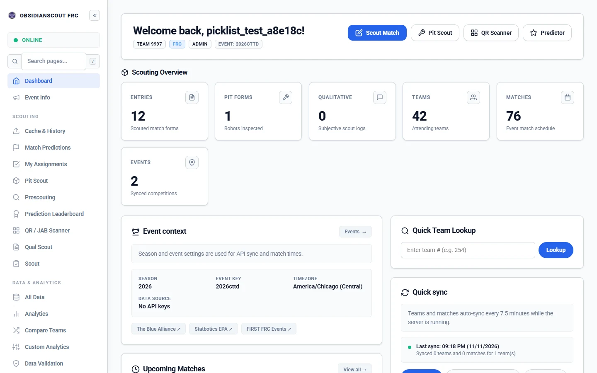

Obsidianscout

See https://obsidianscout.com/docs

## Feature overview

New to ObsidianScout? The [Feature Tour](docs/FEATURE_TOUR.md) walks through every page (scouting, data and analytics, strategy, drive-team tools and admin) with a screenshot of each, and [Getting Started](docs/GETTING_STARTED.md) sets up a team step by step. On a running server, open `/docs`. The full list of guides is in [docs/README.md](docs/README.md).

## License

Copyright (C) 2026 Seth Herod

This project is licensed under the GNU General Public License v3.0 - see the [LICENSE](LICENSE) file for details.
